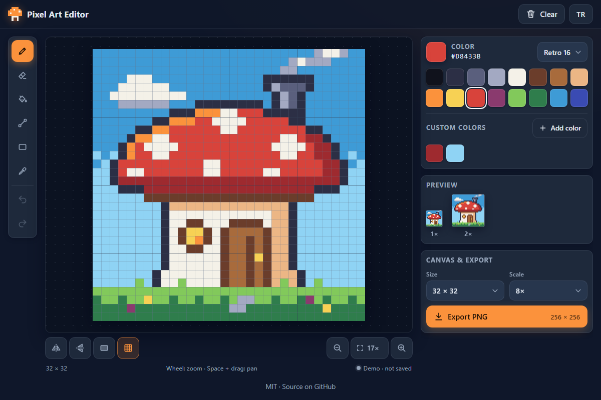

# Pixel Art Editor - draw crisp pixel sprites in the browser with mouse, pen or touch

[](#tests)
[](LICENSE)

**▶ Open the app: https://celaldrg.github.io/pixel-art/**



## Features

- Canvas sizes 16 × 16, 32 × 32 and 64 × 64. Changing the size keeps the artwork centered and can be undone.
- Tools: pencil, eraser, flood fill (4-connected), line (Bresenham), rectangle (outline or filled) and color picker.
- Mirror drawing left ↔ right, top ↕ bottom, or both at once.
- Four original palettes (Retro 16, Earth 8, Pastel 8, Grays 8) plus up to 16 custom colors.
- Undo and redo for the last 100 steps, stored as pixel diffs. A whole stroke is one step.
- Zoom with the buttons, the mouse wheel or a pinch, and pan around. The grid is optional, and live previews show the art at 1× and 2×.
- PNG export at any whole scale from 1× to 16×, with sharp edges and a transparent background.
- Autosave in your browser with a save indicator.
- English and Turkish interface.
- No dependencies and no build step: plain HTML, CSS and JavaScript modules.

## How to use

Pick a tool, pick a color and draw on the canvas. The color picker takes the color of the pixel you click, then switches back to your previous tool. **Add color** opens the system color dialog and keeps the color under *Custom colors*. **Clear** empties the canvas; undo brings it back. To save a file, choose a scale and press **Export PNG**.

| Keyboard | Action |
| --- | --- |
| `B` `E` `G` `L` `R` `I` | Pencil, eraser, fill, line, rectangle, color picker |
| `Ctrl+Z` | Undo |
| `Ctrl+Y` or `Ctrl+Shift+Z` | Redo (`Cmd` works on a Mac) |
| `Esc` | Cancel the line or rectangle you are drawing |
| Mouse wheel | Zoom at the pointer |
| `Space` + drag, or middle-button drag | Pan |

**Touch:** draw with one finger. Two fingers pan and pinch to zoom, and they never paint. With the fill tool, the fill happens when you lift your finger. The page does not scroll while you draw on the canvas.

Your work is saved in this browser a moment after every change. The dot under the canvas shows *Saved*, *Saving…* or *Not saved* (for example in a private window with storage blocked). Adding `?demo` to the address opens a finished sample sprite; demo mode never reads or overwrites your saved work.

## Run locally

Serve the folder with any static file server, for example:

```sh
npx serve .
```

Then open the `http://` address it prints. ES modules do not load from `file://`, so opening `index.html` directly will not work.

## Tests

```sh
node --test
```

The tests use only `node:test` and `node:assert`. They cover:

- flood fill: it fills exactly the connected region, stops at other colors and handles borders and corners;
- Bresenham lines: steep, shallow and reversed lines;
- rectangles and mirror drawing;
- undo and redo restoring the exact pixel data, including long seeded editing sessions;
- the JSON save/load round trip and storage failures;
- PNG pixel rendering, keyboard shortcuts, the demo sprite, the translation tables, the zoom/pan math and the autosave timing.

## Project structure

```text
index.html, style.css   page, inline SVG icons, dark mobile-first theme
src/
  editor.js             editor model: tools, strokes, undo/redo (no DOM)
  fill.js geometry.js   flood fill, lines, rectangles, mirror images
  grid.js history.js    pixel grid helpers, undo/redo diffs
  palettes.js color.js  palettes, custom colors, hex colors
  project.js storage.js JSON save/load, autosave, safe localStorage
  export.js view.js     PNG pixel data, zoom and pan math
  shortcuts.js i18n.js  keyboard shortcuts, English and Turkish strings
  autosave.js demo.js   debounced saving, the ?demo sprite
  main.js stage.js      UI: start-up, canvas input (draw, zoom, pan)
  render.js controls.js UI: canvas drawing, buttons and panels
  translate-dom.js      UI: puts translated text into the page
  download.js           UI: PNG download
test/                   node:test suites
docs/screenshot.png     the picture above
```

## License

[MIT](LICENSE) © 2026 Celalettin Durgaç

## Türkçe

**▶ Uygulamayı aç: https://celaldrg.github.io/pixel-art/**

Tarayıcıda fare, kalem ya da dokunmatik ekranla piksel çizimi yapmanı sağlayan küçük bir editör.

### Özellikler

- 16 × 16, 32 × 32 ve 64 × 64 tuval. Boyut değişince çizim ortada kalır, değişiklik geri alınabilir.
- Araçlar: kalem, silgi, boya kovası (4 komşulu dolgu), çizgi (Bresenham), dikdörtgen (çerçeve ya da dolu) ve damlalık.
- Ayna çizimi: sol ↔ sağ, üst ↕ alt ya da ikisi birden.
- Dört özgün palet (Retro 16, Toprak 8, Pastel 8, Griler 8) ve en çok 16 özel renk.
- Son 100 adım için geri al ve yinele; adımlar piksel farkı olarak tutulur. Bir fırça hareketi tek adımdır.
- Düğmeler, fare tekerleği ya da iki parmakla yakınlaştırma ve kaydırma. Izgara isteğe bağlı; canlı önizleme 1× ve 2× boyutta.
- 1× ile 16× arasındaki her tam sayı ölçekte PNG dışa aktarma: keskin kenarlar, saydam zemin korunur.
- Tarayıcıda otomatik kayıt ve kayıt göstergesi.
- İngilizce ve Türkçe arayüz.
- Bağımlılık ve derleme adımı yok: düz HTML, CSS ve JavaScript modülleri.

### Nasıl kullanılır

Bir araç ve bir renk seç, tuvale çiz. Damlalık tıkladığın pikselin rengini alır, sonra önceki araca döner. **Renk ekle** sistemin renk seçicisini açar ve rengi *Özel renkler* altına ekler. **Temizle** tuvali boşaltır; geri al ile geri gelir. Dosya kaydetmek için bir ölçek seç ve **PNG olarak indir** düğmesine bas.

| Klavye | İşlev |
| --- | --- |
| `B` `E` `G` `L` `R` `I` | Kalem, silgi, boya kovası, çizgi, dikdörtgen, damlalık |
| `Ctrl+Z` | Geri al |
| `Ctrl+Y` ya da `Ctrl+Shift+Z` | Yinele (Mac'te `Cmd` de olur) |
| `Esc` | Çizmekte olduğun çizgiyi ya da dikdörtgeni iptal eder |
| Fare tekerleği | İmlecin olduğu yere yakınlaştırır |
| `Boşluk` + sürükle ya da orta tuşla sürükle | Kaydırır |

**Dokunmatik:** tek parmakla çiz. İki parmak kaydırır ve yakınlaştırır, hiçbir zaman boyamaz. Boya kovasında dolgu parmağını kaldırınca yapılır. Tuvalde çizerken sayfa kaymaz.

Çalışman her değişiklikten kısa süre sonra bu tarayıcıya kaydedilir. Tuvalin altındaki nokta *Kaydedildi*, *Kaydediliyor…* ya da *Kaydedilemedi* gösterir (örneğin depolamanın kapalı olduğu gizli pencerede). Adresin sonuna `?demo` eklersen hazır bir örnek çizim açılır; demo modu kayıtlı çalışmanı okumaz ve üzerine yazmaz.

### Yerelde çalıştırma

Klasörü herhangi bir statik sunucuyla aç, örneğin:

```sh
npx serve .
```

Sonra yazdığı `http://` adresini aç. ES modülleri `file://` üzerinden yüklenmez; `index.html` dosyasını doğrudan açmak çalışmaz.

### Testler

```sh
node --test
```

Testler yalnız `node:test` ve `node:assert` kullanır. Kapsananlar: boya kovasının yalnız bağlı bölgeyi doldurup başka renkte durması (kenar ve köşe durumları dahil); dik, yatık ve ters Bresenham çizgileri; dikdörtgen ve ayna çizimi; geri al/yinele ile piksellerin birebir geri gelmesi (uzun, tohumlu oturumlar dahil); JSON kaydet/yükle döngüsü ve depolama hataları; PNG piksel çıktısı, kısayollar, demo çizimi, çeviri tabloları, yakınlaştırma/kaydırma hesabı ve otomatik kayıt zamanlaması.

### Lisans

[MIT](LICENSE) © 2026 Celalettin Durgaç
